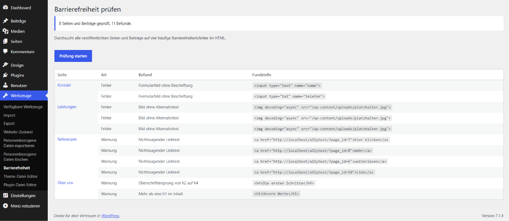

# A11y Content Check

[](https://github.com/messaoudi-dev/a11y-content-check/actions/workflows/tests.yml)

WordPress-Plugin, das alle veröffentlichten Seiten und Beiträge auf vier häufige
Barrierefreiheitsfehler im ausgelieferten HTML prüft und sie mit Fundstelle auflistet.



## Was es prüft

| Prüfung | Beschreibung | Art |
| --- | --- | --- |
| **Bilder ohne Alternativtext** | `` ohne `alt`-Attribut. Ein leeres `alt=""` wird **nicht** gemeldet – es ist die korrekte Angabe für ein dekoratives Bild und sagt dem Screenreader, dass er es überspringen soll. | Fehler |
| **Formularfelder ohne Beschriftung** | `input`, `select` und `textarea` ohne `<label for>`, umschließendes `<label>`, `aria-label`, `aria-labelledby` oder `title`. Knöpfe und `hidden`-Felder sind ausgenommen. | Fehler |
| **Nichtssagende Linktexte** | Linktexte wie „hier klicken", „mehr", „weiterlesen". Screenreader bieten an, alle Links einer Seite als Liste vorzulesen – steht dort zehnmal „mehr", ist die Liste wertlos ([WCAG 2.4.4](https://www.w3.org/WAI/WCAG22/Understanding/link-purpose-in-context.html)). | Warnung |
| **Überschriften-Hierarchie** | Übersprungene Ebenen (`h2` direkt auf `h4`) und mehr als eine `h1` im Inhalt. | Warnung |

## Was es bewusst nicht prüft

Diese Liste gehört zum Werkzeug dazu. Ein Prüfprogramm, das seine Grenzen nicht nennt,
verleitet dazu, sich auf etwas zu verlassen, das es nicht leistet.

- **Kontraste.** Dafür müsste das CSS ausgewertet und die Seite gerendert werden.
- **Inhalte, die erst JavaScript erzeugt.** Geprüft wird das HTML, das WordPress ausliefert.
- **Eine fehlende `h1`.** Geprüft wird nur der Beitragsinhalt; die `h1` einer Seite erzeugt
  in aller Regel das Theme aus dem Titel und ist hier gar nicht sichtbar.
- **Links ohne Text.** Ein Link, der nur ein Bild enthält, bezieht seinen Namen aus dessen
  `alt`. Das zuverlässig zu ermitteln erfordert die vollständige Berechnung des
  Accessible Name – das leistet dieses Plugin nicht.
- Es ist **keine vollständige WCAG- oder BFSG-Prüfung** und ersetzt keinen manuellen Test
  mit Tastatur und Screenreader.

Das Plugin **repariert nichts automatisch**. Einen Alternativtext kann nur ein Mensch
schreiben, der weiß, was auf dem Bild zu sehen ist; automatisch erzeugte alt-Texte sind
oft schlechter als gar keine.

## Installation

```bash
cd wp-content/plugins
git clone https://github.com/messaoudi-dev/a11y-content-check.git
```

Danach im Backend unter **Plugins** aktivieren. Es werden keine Laufzeit-Abhängigkeiten
installiert; Composer wird nur für die Tests gebraucht.

Voraussetzungen: WordPress 6.0 oder neuer, PHP 8.1 oder neuer.

## Benutzung

**Werkzeuge → Barrierefreiheit → Prüfung starten.**

Das Ergebnis erscheint als Tabelle, nach Seite gruppiert, mit der gefundenen Stelle im
HTML und einem Link in den Editor. Es wird nichts in der Datenbank gespeichert – die
Prüfung läuft auf Knopfdruck und ist danach wieder vergessen.

## Aufbau

```
src/
├── Check.php            Schnittstelle aller Prüfungen
├── Finding.php          Ein Befund (unveränderliches Wertobjekt)
├── Html.php             HTML einlesen, UTF-8-sicher
├── Scanner.php          Die einzige Klasse, die WordPress kennt
├── Plugin.php           Hooks registrieren
├── Checks/              Die vier Prüfungen
└── Admin/AdminPage.php  Die Seite unter Werkzeuge
```

Die tragende Entscheidung: **Eine Prüfung kennt WordPress nicht.** Sie bekommt ein
`DOMXPath`-Objekt und gibt `Finding[]` zurück – keine Datenbank, keine Optionen, keine
globalen Variablen. Daraus folgt dreierlei:

1. Jede Prüfung ist mit reinem PHPUnit testbar, ohne WordPress-Installation und ohne
   Testdatenbank. Die einzige WordPress-Funktion, die vorkommt, ist `__()`; der Test
   ersetzt sie in drei Zeilen.
2. Nur `Scanner` weiß, wie man an WordPress-Inhalte kommt.
3. Eine neue Prüfung erfordert keine Änderung an einer bestehenden Datei.

Geprüft wird das Ergebnis des Filters `the_content`, nicht `post_content`: Erst dort sind
Gutenberg-Blöcke aufgelöst und Shortcodes ausgeführt. Das Plugin sieht also dasselbe HTML
wie der Besucher.

## Eigene Prüfung hinzufügen

Eine Klasse anlegen, die `Check` implementiert:

```php
final class MyCheck implements Check {

    public function id(): string {
        return 'my-check';
    }

    public function label(): string {
        return __( 'Meine Prüfung', 'a11y-content-check' );
    }

    /** @return Finding[] */
    public function run( DOMXPath $xpath ): array {
        // ...
    }
}
```

Und sie in `AdminPage::create_scanner()` eintragen. Das ist alles – keine bestehende
Datei wird verändert.

## Filter

| Filter | Beschreibung |
| --- | --- |
| `a11y_content_check_vague_link_texts` | Die Liste der als nichtssagend geltenden Linktexte. Erhält `LinkTextCheck::DEFAULT_VAGUE_TEXTS`, erwartet ein Array aus Zeichenketten. |

```php
add_filter(
    'a11y_content_check_vague_link_texts',
    static function ( array $texts ): array {
        $texts[] = 'siehe dort';
        return $texts;
    }
);
```

## Entwicklung

```bash
composer install
vendor/bin/phpunit
```

27 Tests, kein WordPress nötig. Die CI prüft bei jedem Push die Syntax auf PHP 8.1 bis 8.4
und führt die Tests auf PHP 8.2 bis 8.4 aus.

## Entstehung

Entstanden mit KI-Unterstützung (Claude). Architektur, Zuschnitt der vier
Prüfungen und die Prüfung jeder Ausgabe liegen bei mir; jeder Schritt wurde
lokal auf einer WordPress-Installation getestet, bevor er committet wurde.
Die Commit-Historie zeigt die Reihenfolge.

## Lizenz

GPL-2.0-or-later, wie WordPress selbst.
